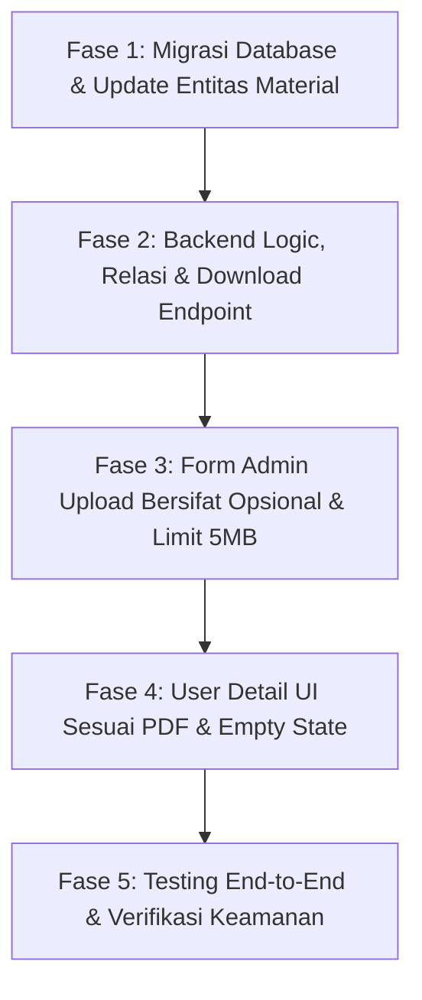

# Implementation Plan Final: Relasi Materi via `syllabusId` di Tabel `material`

- **Dokumen**: `implementation-final.md`
- **Arsitektur**: Menambahkan Foreign Key `syllabusId` pada tabel `material` (`One-to-Many`)
- **Status**: Draf Rancangan Final untuk Review
- **Prinsip**: Skalabel, berkas opsional, batas 5 MB, dan *Persistent Header Empty State*.

---

## 1. Keputusan Arsitektur (ADR)

### Pilihan Model Data: `syllabusId` Masuk ke Tabel `material`
Alih-alih menaruh kolom berkas statis di tabel `syllabus`, kita menambahkan kolom `syllabusId` langsung pada tabel `material` yang sudah ada:

```
┌────────────────────────────────────────────────────────┐
│                   Table: syllabus                      │
├────────────────────────────────────────────────────────┤
│ id                 : uuid (PK)                         │
│ title              : varchar                           │
│ content            : jsonb (teori EditorJS/HTML)       │
│ syllabusNumber     : int                               │
│ isFinal            : boolean                           │
└──────────────────────────┬─────────────────────────────┘
                           │ 1 (One)
                           │
                           │ N (Many)
┌──────────────────────────▼─────────────────────────────┐
│                   Table: material                      │
├────────────────────────────────────────────────────────┤
│ id                 : uuid (PK)                         │
│ title              : varchar (misal: "Modul PDF")      │
│ file               : varchar (URL / Path lokal)        │
│ fileType           : enum ('video', 'pdf', 'ppt')      │
│ driveFileId        : varchar (nullable)                │
│ sessionId          : uuid (nullable)  ──> Bootcamp     │
│ syllabusId         : uuid (nullable)  ──> Silabus      │
│ originalFileName   : varchar (nullable)                │
│ fileSizeBytes      : bigint (nullable, maks 5 MB)      │
│ durationSeconds    : varchar (nullable)                │
└────────────────────────────────────────────────────────┘
```

### Mengapa Memilih Model Ini?
1. **Dinamis & Skalabel**: Satu silabus di masa depan tidak dibatasi hanya 1 PDF atau 1 PPT. Admin bisa mengunggah lebih dari 1 modul bacaan jika kurikulum berkembang.
2. **Memanfaatkan Ekosistem `Material` yang Sudah Ada**: Menggunakan kembali entitas `Material`, tipe berkas (`pdf`, `ppt`, `video`), dan penanganan Google Drive yang sudah matang di LMS.
3. **Pemisahan Kepemilikan yang Jelas**: Baris materi bootcamp memiliki `sessionId`, sedangkan materi silabus memiliki `syllabusId`. Keduanya tidak saling tumpang tindih.

---

## 2. Aturan Bisnis & Spesifikasi Kunci

1. **Sifat Berkas: 100% Opsional**
   - Di form silabus admin, pengisian link video, modul PDF, dan slide PPTX bersifat **opsional**.
   - Silabus tetap sah disimpan meski tanpa berkas pendukung.
2. **Batas Ukuran Upload: Maksimal 5 MB**
   - Validasi upload membatasi ukuran file PDF dan PPT/PPTX maksimal **5 MB** (`5.242.880` bytes).
3. **Aturan Integritas Data (Data Integrity)**:
   - Kolom `sessionId` di tabel `material` diubah menjadi `NULLABLE`.
   - Sebuah baris `material` harus memiliki tepat satu pemilik: `sessionId` ATAU `syllabusId`.
   - `ON DELETE CASCADE`: Jika silabus dihapus, seluruh materi milik silabus tersebut otomatis terhapus tanpa menyentuh materi sesi bootcamp.
4. **Empty State dengan Persistent Header (Header Card Tidak Boleh Hilang)**:
   - Jika silabus tidak memiliki materi:
     - **Header Card Video Pembelajaran TETAP TAMPIL**: Menampilkan header `Video Pembelajaran` dengan durasi `-`. Body menampilkan placeholder abu-abu netral dengan pesan *"Video pembelajaran belum tersedia untuk silabus ini."*
     - **Header Card Materi Pembelajaran TETAP TAMPIL**: Menampilkan header `Materi Pembelajaran` dan subjudul *"Lihat atau unduh materi pendukung sebelum mengerjakan quiz."* Body menampilkan kotak dashed border dengan pesan *"Belum ada modul PDF atau slide presentasi yang diunggah untuk silabus ini."*
     - **Card Quiz & Card Cara Belajar** tetap berada di posisinya di bawah Card Materi.

---

## 3. Spesifikasi Migrasi Database

File migrasi TypeORM: `src/database/migrations/[timestamp]-AddSyllabusIdToMaterials.ts`

```sql
-- 1. Buat sessionId menjadi nullable agar material bisa dimiliki silabus
ALTER TABLE "material" ALTER COLUMN "sessionId" DROP NOT NULL;

-- 2. Tambahkan kolom syllabusId dan metadata berkas
ALTER TABLE "material"
  ADD COLUMN IF NOT EXISTS "syllabusId" uuid NULL,
  ADD COLUMN IF NOT EXISTS "original  FileName" character varying NULL,
  ADD COLUMN IF NOT EXISTS "fileSizeBytes" bigint NULL,
  ADD COLUMN IF NOT EXISTS "durationSeconds" character varying NULL;

-- 3. Tambahkan Foreign Key ke tabel syllabus
DO $$
BEGIN
  IF NOT EXISTS (
    SELECT 1 FROM pg_constraint WHERE conname = 'FK_material_syllabus'
  ) THEN
    ALTER TABLE "material"
      ADD CONSTRAINT "FK_material_syllabus"
      FOREIGN KEY ("syllabusId") REFERENCES "syllabus"("id")
      ON DELETE CASCADE ON UPDATE NO ACTION;
  END IF;
END $$;

-- 4. Index untuk performa query silabus
CREATE INDEX IF NOT EXISTS "IDX_material_syllabusId" ON "material" ("syllabusId");
```

---

## 4. Rincian Modifikasi Kode Program

### A. Entitas Backend (`src/entities/`)
1. **`src/entities/materials.entity.ts`**
   - Jadikan relasi `session` menjadi opsional (`nullable: true`).
   - Tambahkan relasi ke `Syllabus`:
     ```typescript
     @ManyToOne(() => Syllabus, (syllabus) => syllabus.materials, {
       onDelete: 'CASCADE',
       nullable: true,
     })
     @JoinColumn({ name: 'syllabusId' })
     syllabus?: Syllabus;
     ```
   - Tambahkan properti metadata:
     ```typescript
     @Column({ nullable: true })
     originalFileName?: string;

     @Column({ type: 'bigint', nullable: true })
     fileSizeBytes?: number | string;

     @Column({ nullable: true })
     durationSeconds?: string;
     ```
2. **`src/entities/syllabus.entity.ts`**
   - Tambahkan relasi `OneToMany` ke `Material`:
     ```typescript
     @OneToMany(() => Material, (material) => material.syllabus, {
       cascade: true,
       onDelete: 'CASCADE',
     })
     materials: Material[];
     ```

### B. Service & Controller
3. **`src/syllabus/syllabus.service.ts`**
   - Pada `findDetailForUser(syllabusId, userId)`:
     - Ambil silabus beserta relasi `materials`.
     - Kelompokkan materi berdasarkan `fileType`:
       * `video`: Materi video utama (diambil yang pertama jika ada).
       * `pdfList`: Daftar dokumen PDF (dengan format ukuran `MB`/`KB`).
       * `pptList`: Daftar presentasi PPT/PPTX (dengan format ukuran `MB`/`KB`).
     - Tentukan flag ketersediaan:
       * `hasVideo`: `boolean` (apakah ada video).
       * `hasAnyMaterial`: `boolean` (`pdfList.length > 0 || pptList.length > 0`).
4. **`src/syllabus/syllabus.controller.ts`**
   - **Upload pada Create/Update Silabus:**
     - Menggunakan `FileFieldsInterceptor` untuk menangani field file `pdfFile` dan `pptFile` (max 5 MB).
     - Jika ada file PDF diunggah, buat baris `Material` baru dengan `fileType = 'pdf'`, `fileSizeBytes = file.size`, `originalFileName = file.originalname`, `syllabusId = syllabus.id`.
     - Jika ada file PPTX diunggah, simpan berkas asli dan buat baris `Material` dengan `fileType = 'ppt'`.
     - Jika ada input `videoUrl`, buat baris `Material` dengan `fileType = 'video'`.
   - **Download Endpoint:**
     - `GET /syllabus/learn/:syllabusId/materials/:materialId/download`
     - Memverifikasi apakah materi tersebut benar milik silabus tersebut dan user terdaftar di program.
     - Mengirimkan file menggunakan nama file asli (`res.download(filePath, originalFileName)`).

### C. Proteksi Service Lama Bootcamp (`src/materials/material.service.ts`)
- Pastikan method `findMateriBypertemuan`, `findMaterialPdf`, `findMaterialPpt`, dan `findMaterialVideo` tetap memfilter secara ketat berdasarkan `session: { id: sessionId }`.
- Dengan filter ini, berkas silabus dijamin **tidak akan pernah muncul di halaman bootcamp**.

### D. Tampilan User (`src/views/user/syllabus/detail.hbs`)
- **Kolom Kiri:**
  1. *Card 1 (Video Pembelajaran)*:
     - Header selalu tampil: Ikon play + teks `Video Pembelajaran`.
     - Jika `hasVideo`: Render pemutar video (YouTube iframe embed atau HTML5 video player) + durasi di kanan atas.
     - Jika tidak ada video: Render box placeholder abu-abu netral dengan teks *"Video pembelajaran belum tersedia untuk silabus ini."*
  2. *Card 2 (Konten Teori)*:
     - Teks dasar teori silabus lengkap dengan gambar ber-caption, list, dan subbab tanpa highlight kuning inline.
- **Kolom Kanan (Sidebar 360px):**
  1. *Card 1 (Materi Pembelajaran)*:
     - Header selalu tampil: Ikon buku + teks `Materi Pembelajaran` + subjudul panduan.
     - Jika `hasAnyMaterial`: Tampilkan daftar item berkas:
       - Modul PDF (badge merah `PDF`, nama file asli, ukuran `MB`, tombol `Lihat PDF`, tombol icon `Download`).
       - Slide PPTX (badge biru `PPTX`, nama file asli, ukuran `MB`, tombol `Lihat Slide`, tombol icon `Download`).
     - Jika tidak ada materi: Tampilkan box *empty state* border putus-putus dengan teks *"Belum ada modul PDF atau slide presentasi yang diunggah untuk silabus ini."*
  2. *Card 2 (Status & Aksi Quiz)*:
     - Posisi tepat di bawah Card Materi.
     - Badge status attempt (`Belum dikerjakan`, `Belum Lulus`, `Lulus`).
     - Skor terbaik dan ambang nilai kelulusan.
     - Tombol CTA dinamis: `Kerjakan Quiz` / `Kerjakan Ulang` / `Lihat Quiz`.
  3. *Card 3 (Cara Belajar)*:
     - Posisi paling bawah sidebar.

---

## 5. Wireframe Tampilan (Kondisi Kosong / Empty State)

```
+---------------------------------------------------------------------------------------------------------+
| Breadcrumb: Home / My Learning / Start Learning / Silabus                                               |
+---------------------------------------------------------------------------------------------------------+
| Judul Halaman: {{syllabus.title}}                                                                       |
+-------------------------------------------------------------------+-------------------------------------+
| KOLOM KIRI (Konten & Media)                                       | KOLOM KANAN (Sidebar 360px)         |
+-------------------------------------------------------------------+-------------------------------------+
| [ CARD 1: VIDEO PEMBELAJARAN ]                                    | [ CARD 1: MATERI PEMBELAJARAN ]     |
| +---------------------------------------------------------------+ | +---------------------------------+ |
| | (>) Video Pembelajaran                                    [-] | | | (i) Materi Pembelajaran         | |
| | +-----------------------------------------------------------+ | | | Lihat/unduh materi sebelum quiz | |
| | |                                                           | | | |                                 | |
| | |              (Ikon Video Placeholder)                     | | | | +-----------------------------+ | |
| | |      "Video pembelajaran belum tersedia untuk silabus ini"| | | | | (Ikon File Kosong)          | | |
| | |                                                           | | | | | Belum ada modul PDF atau    | | |
| | +-----------------------------------------------------------+ | | | | slide materi untuk silabus  | | |
| +---------------------------------------------------------------+ | | | ini.                          | | |
|                                                                   | | +-----------------------------+ | |
| [ CARD 2: KONTEN TEORI & ILUSTRASI ]                              | +---------------------------------+ |
| +---------------------------------------------------------------+ |                                   | |
| | PENGANTAR BUSINESS MODEL CANVAS (BMC) ...                     | | [ CARD 2: STATUS & AKSI QUIZ ]    | |
| | Tujuan Belajar, Dasar Teori, Gambar Ilustrasi ...             | | +---------------------------------+ |
| |                                                               | | | (Medal) [Belum dikerjakan]      | |
| |                                                               | | | Kerjakan quiz silabus ini ...   | |
| |                                                               | | | [ Kerjakan Quiz ]               | |
| +---------------------------------------------------------------+ | +---------------------------------+ |
|                                                                   | [ CARD 3: CARA BELAJAR ]            | |
|                                                                   | +---------------------------------+ |
|                                                                   | | Panduan belajar tetap tampil    | |
|                                                                   | +---------------------------------+ |
+-------------------------------------------------------------------+-------------------------------------+
```

---

## 6. Urutan Fase Eksekusi



### Fase 1: Migrasi Database & Update Entitas
- Jalankan migrasi penambahan `syllabusId` dan kolom metadata pada tabel `material`.
- Update entitas `Material` dan `Syllabus`.

### Fase 2: Backend Logic & Download Endpoint
- Perbarui `findDetailForUser` untuk mengambil `materials` berelasi.
- Buat route download `/syllabus/learn/:syllabusId/materials/:materialId/download`.
- Pastikan query bootcamp di `material.service.ts` tetap aman dan terisolasi.

### Fase 3: Form Admin
- Tambahkan input upload PDF, PPTX (opsional, maks 5 MB), dan Video URL pada form silabus admin.
- Saat admin submit, simpan data ke tabel `material` dengan mengaitkan `syllabusId`.

### Fase 4: Template Peserta `detail.hbs`
- Susun layout sesuai PDF target:
  - Card Video di kiri atas (dengan fallback empty state).
  - Card Teori di kiri bawah.
  - Card Materi di kanan atas (dengan fallback empty state).
  - Card Quiz di kanan tengah.
  - Card Cara Belajar di kanan bawah.
- Pastikan semua header card tidak pernah hilang.

### Fase 5: Testing & Verifikasi
- Uji silabus dengan materi lengkap.
- Uji silabus tanpa materi (empty state).
- Uji batas file 5 MB (file > 5 MB wajib ditolak).
- Uji isolasi data bootcamp (pastikan materi silabus tidak muncul di sesi bootcamp).
