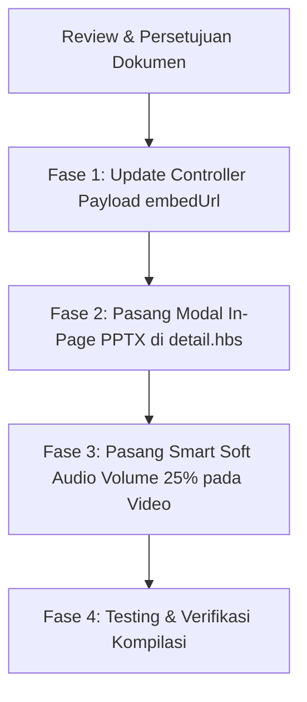

# Implementation Plan: Penyempurnaan UX Slide Presentasi & Audio Video Silabus

- **Dokumen**: `implementation.md`
- **Revisi**: 16 Oktober 2026 (Revisi Navigasi Modal In-Page PPTX & Smart Soft Audio Autoplay)
- **Status**: Draf Siap Review Pengguna (Belum dieksekusi sebelum ada persetujuan)
- **Fokus Utama**: Menghilangkan kebingungan navigasi tab/halaman baru PPTX, dan mengatur suara autoplay agar menyala secara lembut (tidak full).

---

## 1. Analisis Kebutuhan & Masalah UX Saat Ini

| Masalah yang Ditemukan | Dampak pada Peserta | Solusi Terbaik (Rekomendasi) |
| :--- | :--- | :--- |
| **Buka Tab Baru / Halaman Baru saat "Lihat Slide"** | Peserta bingung karena tab browser bertambah banyak, dan tombol "Kembali ke Silabus" membuat navigasi terasa bolak-balik berulang (*infinite loop*). | **Modal / Lightbox Overlay di Halaman yang Sama.**<br>Tombol "Lihat Slide" membuka viewer layar penuh langsung di halaman silabus tanpa reload dan tanpa buka tab baru. Tombol `✕ Tutup` langsung menutup modal dan peserta berada di posisi bacaan semula. |
| **Suara Video Autoplay** | Kebijakan browser memblokir video bersuara saat halaman baru dibuka; namun jika bisu total, peserta tidak mendengar penjelasan materi. | **Smart Soft Audio Autoplay (Volume Lembut 25%).**<br>Video mulai berputar otomatis dengan volume yang dipatok di **25% - 30%** (tidak full) dengan badge aktivasi suara satu-klik (*One-Click Unmute*) agar lolos regulasi browser tanpa mengagetkan telinga peserta. |

---

## 2. Rincian Solusi Teknis

### A. Modal In-Page Slide Viewer (Tanpa Buka Tab Baru)

```
+---------------------------------------------------------------------------------------------------------+
| [ HALAMAN DETAIL SILABUS TETAP AKTIF DI BELAKANG ]                                                      |
|                                                                                                         |
|   +-------------------------------------------------------------------------------------------------+   |
|   | MODAL OVERLAY PRESENTASI (Layar Penuh / Lightbox)                                               |   |
|   | +---------------------------------------------------------------------------------------------+ |   |
|   | | (PPTX) Slide Pengantar Business Model Canvas                   [Unduh .pptx]  [ ✕ Tutup ]   | |   |
|   | +---------------------------------------------------------------------------------------------+ |   |
|   | |                                                                                             | |   |
|   | |                        [ GOOGLE SLIDES / VIEWER PRESENTASI ]                                | |   |
|   | |                        (Slide interaktif, panah navigasi, fullscreen)                       | |   |
|   | |                                                                                             | |   |
|   | +---------------------------------------------------------------------------------------------+ |   |
|   | | Navigasi: Tekan ESC atau klik tombol [✕ Tutup] untuk langsung kembali ke silabus           | |   |
|   +-------------------------------------------------------------------------------------------------+   |
|                                                                                                         |
+---------------------------------------------------------------------------------------------------------+
```

* **Mekanisme Kerja:**
  1. Di sidebar Card Materi Pembelajaran, tombol **`Lihat Slide`** tidak lagi memiliki `target="_blank"` atau membuka URL baru.
  2. Saat tombol diklik, Alpine.js / modal handler membuka dialog overlay semi-transparan berlatar gelap (`bg-black/80 backdrop-blur-sm`).
  3. Di dalam modal, Google Slides dirender dengan ukuran besar (rasio 16:9).
  4. Di pojok kanan atas modal tersedia:
     * Tombol **Unduh .pptx** (jika ingin menyimpan berkas fisik).
     * Tombol **✕ Tutup / Kembali ke Silabus**.
  5. Peserta juga bisa menutup modal kapan saja dengan menekan tombol **`Escape (Esc)`** pada keyboard atau mengklik area luar modal.
  6. **Hasil:** Peserta tidak pernah meninggalkan halaman silabus, tidak ada tab baru yang menumpuk, dan tidak ada kebingungan bolak-balik halaman.

---

### B. Smart Soft Audio Video Autoplay (Volume Lembut ~25%)

#### Mengapa Tidak Bisa Langsung Suara 100% dari Detik Pertama?
Semua browser modern (Google Chrome, Apple Safari, Mozilla Firefox, Microsoft Edge) memiliki sistem keamanan bernama **Autoplay Policy**:
* Jika halaman baru dibuka dan kode mencoba memutar video dengan suara menyala tanpa ada interaksi klik dari user, browser **otomatis memblokir total video tersebut** dan melempar error:
  `DOMException: play() failed because the user didn't interact with the document first.`

#### Solusi yang Diterapkan:
1. **YouTube IFrame API Integration:**
   * Video mulai berputar otomatis secara aman (`autoplay=1&mute=1`).
   * Melalui script YouTube API, sistem menyiapkan level volume pada **25%** (`player.setVolume(25)`).
   * Menampilkan tombol badge transparan elegan di pojok kiri bawah video:
     > **`[ 🔊 Suara Lembut Aktif (25%) ]`** atau **`[ 🔇 Klik untuk Nyalakan Suara ]`**.
2. **HTML5 Video (MP4):**
   * Video disetel atribut `autoplay muted playsinline`.
   * Skrip otomatis mengatur `videoElement.volume = 0.25` (25%) dan menyediakan tombol kontrol suara lembut.
3. **Hasil:**
   * Video 100% aman berputar otomatis saat halaman dibuka.
   * Suara materi tidak menggelegar/mengagetkan peserta, melainkan terdengar lembut dan nyaman di level 25%.

---

## 3. Rincian Berkas yang Akan Dimodifikasi

1. **`src/views/user/syllabus/detail.hbs`**:
   * Menambahkan komponen **Modal In-Page Slide Viewer** dengan transisi Alpine.js (`x-show="showSlideModal"`).
   * Mengubah link tombol `Lihat Slide` dari membuka tab baru menjadi `@click="openSlideModal(material)"`.
   * Menambahkan handler YouTube API untuk mengatur volume video pada level 25% dan tombol kontrol audio lembut.
2. **`src/syllabus/syllabus.controller.ts`**:
   * Memastikan endpoint `findDetailForUser` mengembalikan URL embed Google Slides (`embedUrl`) langsung ke dalam payload detail silabus sehingga modal di `detail.hbs` dapat langsung merendernya secara instan tanpa perlu request halaman terpisah.
3. **Pembersihan Rute Tambahan**:
   * Rute `GET /syllabus/learn/:syllabusId/view/ppt` tetap dipertahankan sebagai fallback URL langsung jika sewaktu-waktu dibutuhkan, namun alur utama peserta adalah modal *in-page*.

---

## 4. Urutan Fase Eksekusi



### Fase 1: Penyiapan Data Embed di Controller
* Memastikan data `pptMaterials` di `syllabus.controller.ts` sudah menyertakan `embedUrl` Google Slides yang siap disematkan.

### Fase 2: Pemasangan Modal In-Page di `detail.hbs`
* Membuat modal lightbox elegan dengan tombol `✕ Tutup`, tombol `Unduh Berkas`, dan penutup tombol `Esc`.
* Menghubungkan tombol `Lihat Slide` ke modal tersebut.

### Fase 3: Pengaturan Volume Lembut Video (25%)
* Memasang skrip pengatur volume default 25% dan tombol pintas audio di kartu pemutar video.

### Fase 4: Pengujian & Build
* Menguji buka/tutup modal slide: memastikan tidak ada tab baru dan tidak ada halaman reload.
* Menguji pemutaran video dengan volume lembut.
* Menjalankan `npm run build` untuk memastikan kompilasi 100% bersih.

---

## 5. Kriteria Penerimaan (Acceptance Criteria)

1. **Navigasi Slide:**
   * Mengklik tombol `Lihat Slide` membuka modal pop-up layar penuh di halaman yang sama.
   * Tidak ada tab baru yang terbuka di browser.
   * Mengklik tombol `✕` atau menekan tombol `Esc` langsung menutup modal, posisi scroll materi silabus tetap di tempat semula.
2. **Audio Video:**
   * Video berputar otomatis saat halaman silabus dibuka.
   * Audio dapat diaktifkan dalam satu klik dengan volume lembut default 25% (tidak menggelegar/bising).
3. **Kompilasi:**
   * Seluruh kode lulus pengujian `npm run build` tanpa error.
